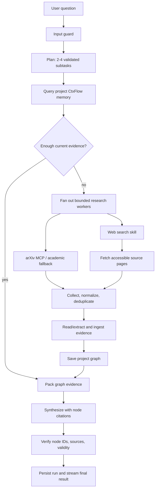

# Minimal Parallel Research Assistant Demo Plan

**Status:** Implemented (offline-tested; live rehearsal is opt-in) — see "Implementation notes" below  
**Repository snapshot reviewed:** 28 Oct 2026  
**Goal:** Add query decomposition and bounded parallel research to the existing ResearchOS workflow, use MCP-backed academic search plus a general-web source skill, and store/retrieve evidence through the project-scoped CtxFlow graph.

## 1. Demo Goal

A researcher asks a compound question such as:

> How do graph-based memory systems improve long-horizon retrieval, and what limitations remain compared with vector RAG?

The assistant should:

1. Build a small, inspectable plan with two to four focused research subtasks.
2. Search project memory first, then run the needed source searches concurrently.
3. Use the existing arXiv MCP integration and a new general-web search/fetch skill.
4. Fetch and extract bounded source content, keeping source URLs and access status.
5. Ingest papers and evidence claims into the current project's CtxFlow graph.
6. Synthesize an answer with citations that resolve to graph nodes and source URLs.
7. Stream the plan, subtask progress, source outcomes, and verification to the existing UI.
8. Reuse ingested evidence on a follow-up query without searching again when memory is sufficient.

This is a bounded research workflow, not an unrestricted agent swarm. The planner may propose search queries, but providers, tools, result counts, fetch limits, and the graph write path remain code-controlled.

## 2. Current Capability Audit

| Capability | Current state | Consequence for this demo |
|---|---|---|
| Agent/runtime | `ResearchGraph` runs eight stages and has a sequential fallback. `plan -> retrieve -> read -> memory -> pack -> synthesize -> verify -> persist` is linear; only citation repair loops back to packing. | Extend the existing workflow; do not replace it. |
| Planning | Intent comes from regex classification. `plan` currently records the fixed stage list, not query-specific subtasks. `PlanStep` and run lifecycle types exist but do not drive this workflow. | Add a validated query-decomposition contract and expose it in run state. |
| Parallel work | No parallel branch or concurrent subtask worker is present in `ResearchGraph`. | Add bounded retrieval fan-out and deterministic fan-in. |
| MCP | `ArxivMCPClient` calls `search_papers` over stdio, started lazily, with arXiv HTTP fallback. | Reuse this integration. Do not start a second MCP server until its package/version and behavior pass a smoke test. |
| Academic search | `LiteratureSearchSkill` supports arXiv, Semantic Scholar, and OpenAlex with TTL caching and explicit provider outcomes. The aggregate `both` path is not a general-web search. | Preserve it as the academic-source skill and make provider outcomes visible per subtask. |
| General web | No DuckDuckGo/general-web search or page-fetch implementation was found. | Add a small, replaceable web search skill and a bounded source-fetch/extraction path. |
| Skill registry | Skills are schema-described and registered by the API, but the research workflow receives direct skill instances and does not dispatch through the registry. | Route the new worker's allowlisted tool calls through one injected registry/skill boundary, or document and test a narrow workflow adapter to it. |
| Research memory | Each project has a separate `CtxFlow` graph; papers and claims are queried, ingested, traced, and saved as JSON by `ResearchWorkspace`. | Use this as the demo's source of truth for project research memory. |
| `ctxflow.memory` package | A separate async `MemoryStore` and optional `ContextProvider` exist. The app can initialize the provider behind a flag, but the workflow does not retrieve from it. | Do not conflate this package with the graph used for research evidence. Conversation prompts and answers are stored as session-scoped run records; bounded prior turns may clarify follow-ups but are not evidence. |
| Persistence/recovery | Project graphs and session-scoped run records are persisted to files. A prompt is saved as a running record before execution and updated with its synthesized answer/status afterward. The orchestrator creates a default in-memory LangGraph checkpointer; the stream route builds a workflow per request. There is no durable checkpoint/restart-resume API. | The demo can persist completed evidence, conversation turns, and run history; do not advertise workflow crash recovery. |
| Evidence | Reader ingests search metadata and abstract-derived claims. Remote PDF acquisition and general-web content extraction are not wired; page/span provenance is incomplete for abstract-derived claims. | Store honest source type/access status and exact extracted excerpts; never present abstract evidence as full text. |
| UI | React sources are in `frontend/`; Vite builds into `src/researchos/web/`, which FastAPI serves. The UI already shows stages, run history, citations, and trace. | Extend the current workflow view and rebuild the bundled UI; no new frontend app is needed. |

## 3. Source-of-Truth and Scope Decisions

1. Keep `CtxFlow`/`ContextGraph` as the research memory path. Project separation currently comes from one graph per project in `ResearchWorkspace`; node metadata also records `project_id`.
2. Use `ctxflow.query()` / `GraphQuerySkill` for memory retrieval and `ctxflow.ingest()` for papers, extracted claims, and source evidence. Persist through `ResearchWorkspace.save_graph(project_id)`.
3. Keep `ctxflow.memory.MemoryStore` integration deferred. Its current adapter is not used by this workflow and would add a second memory lifecycle to the demo.
4. Reuse LangGraph and the current stage/event/result contracts. Parallelism is limited to planned subtask workers in retrieval; there is no free-roaming agent loop.
5. Keep the existing sequential orchestrator as a fallback. It must call the same bounded parallel worker service so results have the same schema and ordering.
6. Resolve documentation drift before claiming a final architecture decision: ADR-001 is still marked proposed, while the implementation, dependency extras, tests, and demo script already use LangGraph. The old orchestration and memory skill snapshots also describe earlier code. Record the approved decision and update those docs in a separate, small documentation change.

## 4. Target Flow



The graph can keep the current public stages. Add `tasks`/`sources` to stage event data and final run records instead of multiplying top-level UI stages. Within `retrieve`, each worker emits a task event with `task_id`, provider, status, result count, and elapsed time. The merge order is stable (`task_index`, provider name, canonical source ID), independent of completion order.

## 5. Contracts to Freeze Before Implementation

### Research plan

```text
ResearchPlan
  primary_question: str
  subtasks: list[ResearchTask]   # 2-4 items for a decomposable query
  planner: str                   # model | deterministic_fallback

ResearchTask
  task_id: str                   # stable within run, e.g. task-01
  query: str                     # bounded search string
  purpose: str                   # why this subtask is relevant
  providers: list[str]           # allowlisted identifiers only
```

Validate planner output before execution: exactly 2-4 unique tasks for a decomposable multi-part query; non-empty bounded strings; no arbitrary tool names; provider list drawn from a fixed allowlist. If model planning fails, use a deterministic splitter/template and record that fallback. Keep the original question for final synthesis. A simple query may produce one task; the demo acceptance query must exercise multiple tasks.

### Source and evidence records

Normalize provider-specific results into a shared record without losing provenance:

```text
SourceRecord
  source_id: str                 # DOI, arXiv ID, canonical URL, then cautious title hash
  provider: str
  source_kind: academic | web
  title: str
  url: str
  retrieved_at: str
  access_status: abstract_only | full_text | unavailable | failed
  text: str                      # only content actually returned/fetched
  task_ids: list[str]
  metadata: dict
```

Represent source papers and evidence in the existing graph: one paper/source node, then claim or excerpt nodes linked with `extracted_from`. Keep `source_url`, `provider`, `source_kind`, `access_status`, `retrieved_at`, `source_paper_node_id`, and where available `section`, `page`, `span_start`, `span_end`, and extraction confidence in metadata. Abstract sentences are explicitly `abstract_only`. Web excerpt text must be retained exactly enough to support a verifiable citation; do not fabricate pages or quotes.

### Run result and events

Add to the existing result contract without removing current keys:

- `plan`: validated plan and planner/fallback label.
- `tasks`: task IDs, subtask text, provider statuses, and counts.
- `sources`: normalized source metadata plus created graph node IDs.
- `events`: existing stage events plus task-level progress.
- `cited_nodes`, `alerts`, `verdict`, `errors`, and `degraded` remain authoritative.

Failed providers must remain distinguishable from valid empty results. A partial provider failure can yield a degraded run if usable evidence remains; no usable evidence should produce an explicit insufficient-evidence answer.

## 6. Implementation Slices

### Slice 0: Freeze scope and baseline

**Files:** `docs/adr/001-orchestration-runtime.md`, `docs/MVP_IMPLEMENTATION_PLAN.md`, `researchos_team_skills/researchos-orchestration/SKILL.md`, relevant test commands.

- Confirm LangGraph remains the MVP runtime and update ADR status/decision to match the code, or record the approved alternative before code changes.
- State that this demo uses CtxFlow project graphs, not `ctxflow.memory` as a second store.
- Capture current focused test baseline for workflow, MCP, evidence API, demo corpus, and frontend build.
- Freeze the result/event fields in Section 5 before parallel work begins.

**Gate:** the team agrees on the contracts and demo query; no API field meanings are ambiguous.

### Slice 1: Add a general-web search and fetch skill

**Files:** new `src/researchos/skills/web_search.py` and `source_fetch.py` (or a single module if the team prefers); `src/researchos/skills/registry.py`; `src/researchos/api/server.py`; `pyproject.toml`; focused tests.

- Add a `WebSearchSkill` with a provider interface. Start with a DuckDuckGo-compatible `ddgs` adapter or another approved provider; keep it replaceable and return `SearchOutcome`-style status rather than a bare list.
- Add bounded page fetching for public HTTP(S) URLs and readable-text extraction. Reuse existing `httpx`; add an optional parser dependency (for example `trafilatura`) only if the extraction tests demonstrate that it is needed.
- Register `web_search` and `fetch_source` with schemas and stable names. Use only these allowlisted capabilities from retrieval workers.
- Reuse the current arXiv MCP client. Keep MCP command/args configurable and pinned for the demo environment; do not pass model or MCP server arbitrary shell commands.
- Deduplicate by DOI, arXiv ID, canonical URL, then cautious normalized title. Preserve provider/source attribution when records merge.
- Enforce per-call timeout, max result count, max response bytes, bounded redirects, content-type checks, and per-host request limits. Reject localhost/private-network destinations and non-HTTP schemes. Respect robots/access rules; do not bypass authentication, paywalls, or rate limits.
- Treat fetched documents as untrusted input using the existing `wrap_untrusted` path and keep them separate from instructions.

**Suggested demo defaults:** at most 4 subtasks, 2 concurrent workers, 3 results/provider/task, 4 fetched pages/run, 8-second fetch timeout, 1 MB/page, and a 90-second total run budget. Make these configuration values explicit and test their enforcement.

**Gate:** mocked provider tests cover success, empty, partial, timeout, malformed response, blocked URL, redirect/size limits, deduplication, and text extraction. No live network is required in CI.

### Slice 2: Plan subtasks and execute bounded parallel workers

**Files:** `src/researchos/orchestration/state.py`, `src/researchos/orchestration/workflow.py`, likely a small `src/researchos/orchestration/research_tasks.py`, `src/researchos/api/server.py`, workflow tests.

- Add typed plan/task records to `ResearchState`; keep the plan immutable after validation.
- Replace the current stage-list-only plan payload with a planner step. Prefer `ModelGateway.complete_json()` when configured; validate its output and fall back deterministically on absent/invalid model output.
- Plan from the user question, not from untrusted search results. The model may suggest query text and purpose only; providers and tools are selected by application policy.
- Query internal project memory first. If current graph evidence meets the sufficiency threshold, skip external work unless the plan explicitly requires fresh sources.
- When external work is needed, run independent task workers through a bounded executor. Each worker receives only its task, project ID, provider allowlist, limits, and cancellation signal. Use `asyncio.to_thread`/worker execution for current synchronous provider clients so network I/O does not block the API event loop.
- Collect all results before reading/ingestion. Sort by stable task/provider/source keys, deduplicate, and cap the merged set. Completion timing must not change the final source order or graph IDs chosen for the same recorded inputs.
- Emit `task_started`, `task_completed`, `task_failed`, and `task_skipped` event payloads while retaining existing stage event names for current UI consumers.
- Ensure the sequential fallback invokes the same task executor and produces equivalent task/result schemas. No separate unbounded execution path.

**Gate:** tests prove at least two workers overlap under controlled fakes; the configured concurrency cap is never exceeded; output ordering is stable under shuffled completion; a failed task does not hide successful sibling evidence; cancellation and wall-time caps stop new work.

### Slice 3: Ingest source-backed evidence into project CtxFlow

**Files:** `src/researchos/agents/reader.py`, `src/researchos/skills/paper_reader.py`, `src/researchos/orchestration/workflow.py`, relevant CtxFlow graph tests only if required.

- Make the Reader consume normalized `SourceRecord` objects from both academic and web providers.
- Create/reuse source nodes with stable source IDs; avoid duplicate source nodes across tasks and follow-up queries.
- Extract claims/excerpts from fetched text when available; otherwise create abstract-derived claims and mark them `abstract_only`.
- Preserve source-to-claim `extracted_from` edges, provider, source URL/identifier, retrieval time, and extraction/access metadata.
- Run the existing contradiction/supersession detection path where supported; keep its limits visible and do not claim that every external contradiction is automatically detected.
- Persist the project's graph before context packing, as the existing workflow already does.
- Never ingest a search snippet as though it were a full document. Keep search snippet, fetched source text, and abstract text distinguishable.

**Gate:** ingesting the same source twice creates no duplicate paper node; every evidence claim resolves to a source node; project A cannot see project B's graph; abstract-only and full-text access states survive save/reload.

### Slice 4: Evidence-grounded synthesis and API payload

**Files:** `src/researchos/orchestration/workflow.py`, `src/researchos/agents/synthesizer.py`, `src/researchos/agents/critic.py`, `src/researchos/api/schemas.py`, server run persistence, tests.

- Pack CtxFlow results under the existing token budget and preserve superseded/contested alerts.
- Give the synthesizer only selected evidence nodes, source metadata, and the original question. Require each structured claim to cite one or more supplied node IDs.
- Extend verification to reject nonexistent IDs, IDs not included in the packed context, and superseded IDs presented as current support. Include source URL/access status in citation resolution.
- If verification flags evidence, preserve the current bounded repair limit; do not turn repairs into additional research-plan generation.
- Persist final plan, task outcomes, source records/IDs, and events in the existing run JSON. The `RunRecord` module can be adopted only if wired end-to-end; do not imply that its types alone provide persistence.
- Return a concise, explicit insufficient-evidence answer when source fetches fail or selected evidence cannot support the answer.

**Gate:** every cited ID resolves to a graph node; every external source citation has a URL and access status; unsupported text is stripped or qualified; provider/model errors are visible as degraded or failed outcomes, never as fabricated success.

### Slice 5: Stream task progress and expose it in the existing UI

**Files:** `src/researchos/api/server.py`, `frontend/src/types.ts`, `frontend/src/hooks/useWorkflow.ts`, `frontend/src/components/ChatPanel.tsx`, relevant trace/source components; build output in `src/researchos/web/`.

- Send the validated plan in the `plan` event and task progress as `task` events. Include provider, status, elapsed time, and result counts, not raw prompts or unbounded source bodies.
- Include source title, domain/provider, URL, access status, and resolved evidence IDs in the `done` payload or existing run details API.
- Show a compact subtask list with pending/running/completed/failed status beneath the current stage bar. Provide source links and access labels beside answer citations.
- Preserve current stage event behavior, run history, graph trace, and legacy `/api/chat` endpoint compatibility.
- Build the React app with the existing Vite configuration; do not hand-edit generated assets.

**Gate:** frontend build and lint pass; SSE contract test verifies plan/task/done events; UI handles empty plan, task failure, disconnect, degraded run, and final sources without getting stuck busy.

### Slice 6: Demo rehearsal and evaluation

**Files:** `docs/DEMO_SCRIPT.md`, focused workflow/evidence tests, optionally a small fixed evaluation fixture.

- Keep the existing offline demo corpus as the deterministic baseline.
- Add a fixed multi-part query and mock search fixtures so CI proves decomposition, parallel fan-out, merge, CtxFlow ingestion, answer citations, and second-query memory reuse without network access.
- Add an opt-in live rehearsal that proves arXiv MCP was actually used (or clearly reports its HTTP fallback), that the web provider returns a source, and that page extraction succeeds for at least one accessible page.
- Record per-provider outcomes, task latency, total latency, ingested node counts, citation resolution rate, and repeat-query cache/memory behavior.
- Target a warm-cache demonstration under 90 seconds; report provider/model configuration and mark live network steps as environment-dependent.

**Gate:** all offline acceptance tests pass; live smoke test is optional and its result is not used to make CI green.

## 7. Required Tests and Acceptance Criteria

### Planner and workflow

- A compound query produces 2-4 distinct, valid subtasks; a simple query may stay single-task.
- Invalid model JSON, unsafe provider names, duplicate tasks, empty strings, and oversized plans trigger deterministic fallback or rejection.
- For a fixed plan and fixed provider responses, source order, ingested IDs, cited IDs, and event sequence are deterministic.
- Two or more workers overlap; worker count never exceeds the configured cap.
- One provider failure plus one successful provider yields useful evidence and a degraded/partial outcome; all-provider failure yields an honest insufficient-evidence response.
- Existing input guard, bounded repair, cancellation, wall-clock limit, and sequential engine contracts remain covered.

### Sources and CtxFlow

- arXiv MCP parsing and HTTP fallback tests continue to pass.
- Web search outcomes distinguish success, empty, and error; tests use fakes only.
- URL safety tests reject local/private addresses, unsupported schemes, oversized responses, invalid content types, excessive redirects, and non-readable content.
- Dedupe prefers DOI/arXiv ID/canonical URL before conservative title comparison.
- Source and claim nodes preserve provider, URL, access status, project, and provenance edge after JSON save/reload.
- Repeating the same request reuses source nodes; a follow-up query retrieves prior graph evidence and skips external search when sufficient.
- Citations resolve to packed graph nodes and current validity; no arbitrary model-generated ID is accepted.

### API and UI

- SSE emits plan, task lifecycle, stage lifecycle, and final result without exposing secrets or raw tool payloads.
- Run JSON includes plan/task/source outcomes and can be retrieved from run history.
- Existing API consumers that only read current stage and final answer fields continue to work.
- `npm run build` and `npm run lint` pass in `frontend/`.

## 8. Demo Runbook

1. Install the existing `researchos`, `orchestration`, and `mcp` extras plus the chosen web-search/parser extra.
2. Configure model gateway if available; set deterministic fallback mode for extraction to reserve model tokens for planning/synthesis.
3. Start the API and React-backed workspace using the existing server/UI build path.
4. Create/select a project and seed the checked-in demo corpus.
5. Ask the fixed compound research query. Show the plan, at least two concurrent tasks, arXiv MCP outcome, web source outcome, source links, and CtxFlow citations.
6. Open a citation trace and show the source-to-claim chain, including any superseded/contested memory.
7. Ask a focused follow-up; show that the project graph supplies previously ingested evidence without repeating all external searches.
8. Disable or break one provider and repeat once; show a visible partial/degraded result and valid citations from the remaining provider.

Set `RESEARCHOS_EXTERNAL_SEARCH=off` for the fully offline graph workflow. Add a separate, explicit web-search setting so disabling academic search cannot accidentally leave web requests enabled.

## 9. Risks and Cut Lines

| Risk | Mitigation / cut line |
|---|---|
| Planner produces noisy or redundant subtasks | Cap at four; validate and deduplicate; deterministic fallback; test against a small fixed query set. |
| Parallel completion order creates nondeterministic evidence | Stable merge and graph-ingestion order after fan-in; test with randomized delays. |
| MCP startup/download fails during demo | Warm the pinned arXiv MCP server before rehearsal; preserve the tested HTTP fallback and report which transport actually ran. |
| Search provider returns low-quality or non-scholarly pages | Label source kind/provider; favor academic sources for scientific claims; require inspectable fetched text and show source links. |
| Web content contains prompt injection or malicious URLs | Treat content as untrusted; strict URL/redirect/size/time limits; no credentials; never allow source text to select tools. |
| More sources consume the model token budget | Cap sources and excerpts before synthesis; use existing context token accounting; keep full source text out of the synthesis prompt. |
| Current heuristic claim extraction overstates evidence | Mark extraction method/confidence and access status; use excerpts as source-backed evidence; expose uncertainty; keep curated relations clearly labeled. |
| Durable checkpointing expands scope | Defer process-restart resume. Completed run JSON and saved CtxFlow graph are enough for this demo. |
| `ctxflow.memory` integration expands into a second schema | Defer it. Revisit only with a separate project-scope and migration decision. |

**Explicitly out of scope:** a general-purpose agent marketplace, arbitrary dynamic tool discovery, unrestricted browser automation, crawling whole sites, authenticated/paywalled content, persistent multi-process checkpointing, replacing the current graph with `MemoryStore`, learned routing, more than four research subtasks, and broad frontend redesign.

## 10. Repository References Reviewed

- Current workflow and LangGraph topology: `src/researchos/orchestration/workflow.py`, `src/researchos/orchestration/state.py`.
- Agent and intent baseline: `src/researchos/agents/router.py`, `src/researchos/agents/retriever.py`, `src/researchos/agents/reader.py`.
- MCP and provider behavior: `src/researchos/mcp/arxiv.py`, `src/researchos/skills/literature_search.py`, `src/researchos/skills/registry.py`.
- Project graph/run persistence and optional memory adapter: `src/researchos/persistence.py`, `src/researchos/memory/context.py`, `src/researchos/api/server.py`.
- Existing contracts and tests: `src/researchos/api/schemas.py`, `tests/test_langgraph_workflow.py`, `tests/test_arxiv_mcp.py`, `tests/test_context_provider_wiring.py`, `tests/test_runs.py`.
- Current demo/UI references: `docs/DEMO_SCRIPT.md`, `frontend/src/hooks/useWorkflow.ts`, `frontend/src/components/ChatPanel.tsx`, `frontend/vite.config.ts`.
- Documentation requiring reconciliation: `docs/MVP_IMPLEMENTATION_PLAN.md`, `docs/adr/001-orchestration-runtime.md`, `researchos_team_skills/researchos-orchestration/SKILL.md`, and `researchos_team_skills/researchos-ctxflow-memory/SKILL.md`.

## 11. Implementation Notes

- New modules: `skills/web_search.py`, `skills/source_fetch.py`, `orchestration/research_tasks.py`. The workflow, reader, retriever (`skip_external`), server, schemas and React UI were extended; the bundled UI was rebuilt with Vite.
- The result's `plan` key stays the list of stage names for existing consumers; the validated plan is returned as `research_plan`. `tasks`, `sources` and `citations` are additive.
- Web search is opt-in (`RESEARCHOS_WEB_SEARCH=on`) and is forced off by `RESEARCHOS_EXTERNAL_SEARCH=off`.
- Worker tool calls go through a narrow adapter in `ResearchTaskExecutor` that checks the `allow_tool` allowlist (`literature_search`, `web_search`, `fetch_source`); the registry exposes `web_search` and `fetch_source` for discovery only.
- The model planner is only consulted for compound questions. Task events are streamed live but stored in the run record in a deterministic (task, provider) order after fan-in.
- The web UI keeps a stable browser session ID per project, restores that session's prompts and answers from run history, and supplies a bounded window of prior turns to synthesis. Prior turns resolve conversational references; only graph evidence supports research claims and citations.
- Slice 0 (ADR-001 approval and doc reconciliation) is a team decision and was not changed here.